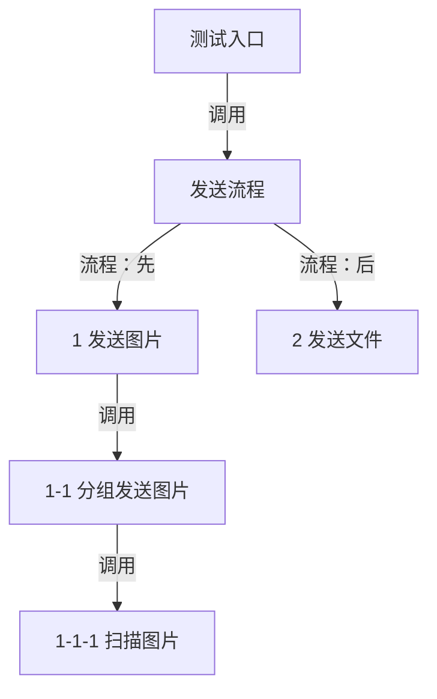

# Code Map

Markdown 保存图、必要说明和源码链接，Mermaid 负责显示。

## 怎么做

1. **确定范围和文件**：读取项目要求、指定入口及已有 Tour/文档。优先用户指定路径或项目文档目录，不明确时先问。
2. **读真实调用关系**：从入口（包括 test）向下核对方法调用、顺序、条件、数据范围和文件/网络操作。Tour 仅作参考。
3. **先画主要流程**：先展示入口与主要流程方法，用 `1`、`2`、`3` 标记关键调用点。独立入口分别画，按本次范围选一种方式，不默认把不同方式混入一图。
4. **再展开子方法**：调用点后先展示重要的被调方法，如 `1-1`，再展开 `1-1-1` 等内部步骤。共用步骤只画一次，其他调用注明使用。
5. **按需拆图**：简单流程一张图足够；过密时拆成总览和局部图。文档按深度优先顺序阅读，编号和源码位置与 Tour 对应。
6. **删减并检查**：补源码链接、方法名和当前行号；删除图已表达的解释，核对源码、节点、边、编号和链接，展示 Markdown。

## 语言与内容

- **简单、准确、易懂**，只用计算机基础词汇和必要业务词，不用互联网黑话。
- 节点直接写动作，如“查询商品”“保留目标门店”“导出表格”“发送文件”。避免抽象名称；方法名放源码索引，只有确有定位需要才写在图上。
- **图已表达的关系，正文不再复述。** 不要求每张图都有说明段落；仅补充重要条件、日期/统计范围和影响结果的风险。
- 同一事实只说明一次；表格已列出数据来源，正文不再重复。源码自明的循环、赋值、编码、日志和 HTTP 字段不展开。
- 优先正面说明实际行为，删除无用的“不是……”“不读取……”等否定解释；会影响操作或结果的限制保留。
- **删掉一句不影响理解，就删。** 如图已有 JSON 到截图的数据边，就不再写“截图读取 JSON，不读取 Excel”。
- 名称准确比纠正段落重要：明确业务日期和功能动作，不用“完整生成”等容易误解的名称再加长篇说明。

## 图怎么画

- ID 用稳定 ASCII（如 `sendImages`），标签用“层级编号＋中文动作”。编号表示归属，顺序或次数按真实代码说明。
- 调用图回答“谁调用谁”，流程图回答“如何执行”；不要把阅读顺序误画成方法调用。
- 实线从实际调用者指向被调方法；方法内的调用点、路由等动作标明“流程”。顺序用边标签表达，多个出边不表示并行。
- 虚线表示数据关系并标注内容，文件或库表用独立数据节点。只画源码中存在的分支、循环和并行。
- 时序比调用结构更重要时，可用 sequenceDiagram；图的数量由阅读需要决定。

## 源码链接与检查

索引列为 `节点 ID / 编号 / 源码 / 方法或位置 / 行号`，可折叠显示。

- 源码位置以项目相对路径为准，链接按文档目录计算。文档在 `doc/` 时，可写 `[Service.java](../src/.../Service.java)`；实际链接必须替换成真实路径。
- 同时列方法名和行号，代码片段注明所属方法；链接用于打开文件，不承诺精确跳行。
- 数据节点列实际文件路径，方法/行号写 `—`；无需执行生成或检查运行期文件是否存在。
- Mermaid click 是可选功能，受预览器设置限制；默认提供普通源码链接，不写死个人绝对路径。
- 检查代码块、节点和索引、父编号、路径与行号；对照源码核对调用者、方法入口、顺序、条件及数据关系。不要用正文关键词次数判断结构正确。
- 再做删除检查。静态检查、Mermaid 解析、图形显示和点击验证分别报告；仅使用已有且获授权的显示工具，不默认下载。

## 工作边界

- 计划或只检查时不写文件。修改保留已有有效内容，删除或大改须获授权；只改指定文档。
- 只读源码，不改业务代码、测试或 Tour，不运行 Maven/构建、应用、数据库、同步或真实请求/发送，不安装依赖，不 Git 暂存提交。
- 不复制密码、Webhook 或 Token，不猜测重试、幂等或成功保证。

## 调用示例

> /skill:code-map 从 test 入口画调用图，只画指定方式，节点用简单动作词，正文只补必要信息。

> /skill:code-map 检查这份图的调用关系、编号和用词，先不修改。
